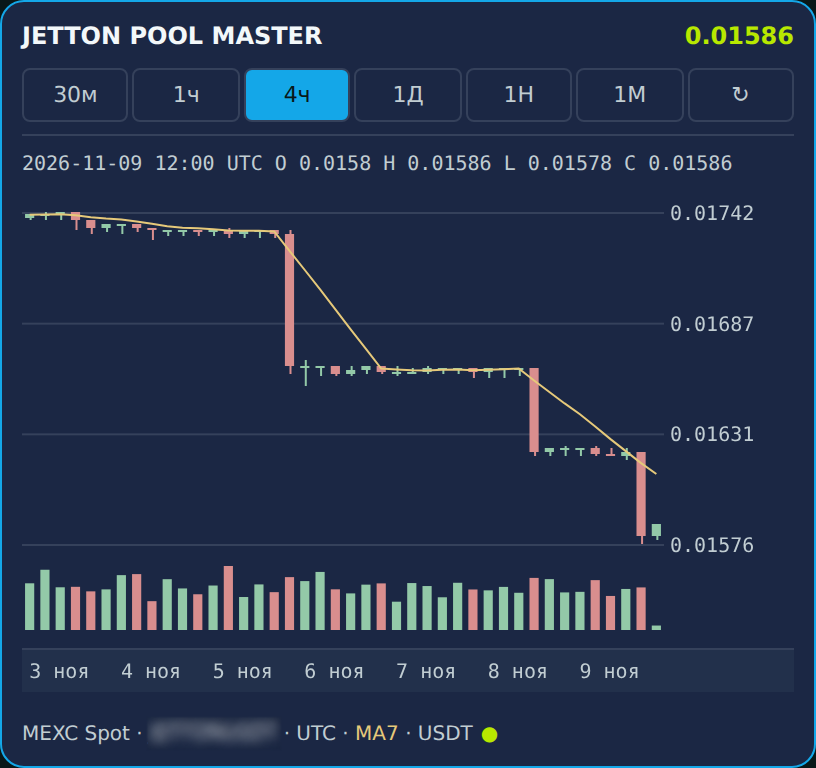
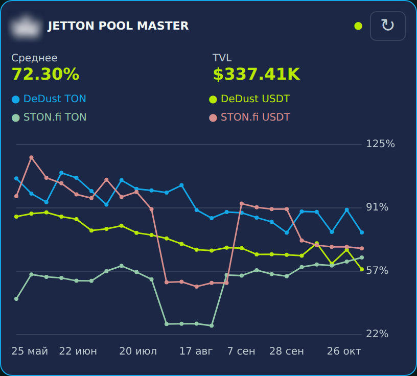
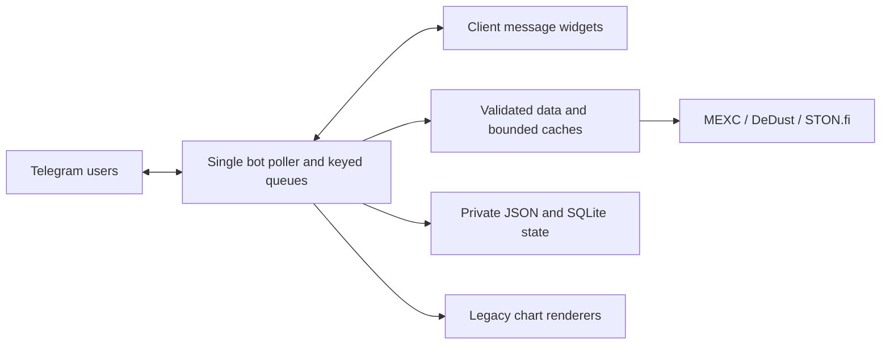

# POOLMASTER

[Русский](README.ru.md) · [Open the bot](https://t.me/JETTONPOOL_BOT)

Telegram bot for JETTON market data, DeFi farming analytics, historical yield charts and personal alerts. The v1.1.0 source-review update adds interactive Telegram message widgets and bounded concurrent user processing.

**Publicly visible, not open source.** Operational use, execution, deployment, modification and redistribution require prior written permission. See [LICENSE.md](LICENSE.md).

## Preview

### Interactive price chart

MEXC Spot candles, USDT volume and MA7. Six in-widget timeframes: 30m, 1h, 4h, 1D, 1W and a calendar month. Drag the plot to browse history; drag the time band to change horizontal scale. Tap a candle for UTC time and OHLC. Refresh updates the quote and 24-hour caption; Back returns to the menu. Browsing history does not replace the current quote with an old candle close.

### Weekly farming history

Four DeDust/STON.fi series, current equal-weight mean and combined TVL. Tap a weekly point for pool values; tap it or the detail card again to close. All available weekly points fit without dragging. Refresh updates the sources and the same message. [Selected-week example](docs/assets/widgets/farming-detail.png).

### Coin menu

Tap to toss a gold coin: marked face or blank reverse, 50/50, with reflection, variable rotation speed, whole-coin bounce and optional haptics. No wagers, statistics or bot request per toss. The public source uses the approved TST vector instead of the private crown.

Illustrations are browser renders of the shipped interface with saved market observations, not live quotes or screenshots of private conversations. Original logos and the related ticker are blurred. Public-source branding differs as documented in [Provenance](PROVENANCE.md).

## Features and scope

- Private price/farming widgets, Russian and English interface, personal alert preferences.
- Persisted confirmed daily farming observations and completed-week summaries; missing observations are not invented.
- Current farming mean is distinct from the mean over historical weeks; an observed 0% remains valid data.
- Independent per-user/message queues with configurable active concurrency and shared bounded source caches.
- Group `/price` and `/farming` retain legacy charts; inline results remain text summaries.
- Administrator broadcasts, managed channel/group publication and access checks.
- Legacy fallback when widget delivery is explicitly unsupported. Widget flags default off in source configuration.

Daily/three-day farming views and group inline widgets are not enabled. The owner's phone and Windows Telegram Desktop 7.4.1 were checked; this is not a guarantee for every Telegram client/version.

## Architecture

HTML/Canvas runs inside Telegram messages. There is no separately hosted frontend, Mini App, public webhook, wallet integration or order execution. Market API access is read-only. See [Architecture](docs/ARCHITECTURE.md), [Widgets](docs/TELEGRAM_WIDGETS.md) and [Data sources](docs/DATA_SOURCES.md).

## Documentation

[User guide](docs/USER_GUIDE.md) · [Administrator guide](docs/ADMIN_GUIDE.md) · [Configuration](docs/CONFIGURATION.md) · [Farming history](docs/FARMING_HISTORY.md) · [Testing](docs/TESTING.md) · [Changelog](CHANGELOG.md)

The technical setup and test commands are documented for separately authorized reviewers/maintainers; they do not expand the license. Python 3.12 and Node 22 are used by CI. Widget templates are committed; Node/Terser are development tools, not bot runtime dependencies.

## Security and provenance

Credentials, user preferences, destination records, widget sessions and runtime databases remain private and outside Git. Tests use synthetic identifiers and mocked transports. See [Security](SECURITY.md).

This repository is an independent source-review snapshot derived from a stable private release. Private Git history, operational reports, original logo assets and deployment material are excluded. Approved compatibility differences are enumerated in [Provenance](PROVENANCE.md); byte-for-byte production identity is not claimed.

## License and disclaimer

**This software is NOT open source.** The [POOLMASTER Source Review License v1.0](LICENSE.md) governs access and use. See [Notice](NOTICE.md), [Third-party notices](THIRD_PARTY_NOTICES.md) and [Contributing](CONTRIBUTING.md).

Market and yield data is informational, not investment advice. Sources may be unavailable, delayed or incorrect. The bot does not control funds or place trades. See [Disclaimer](DISCLAIMER.md).
