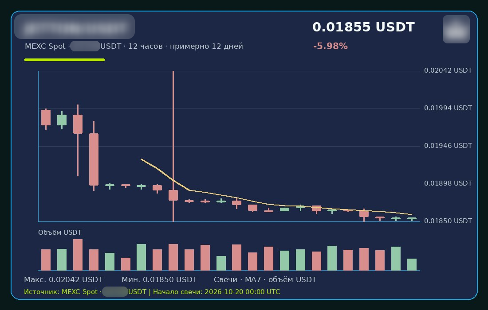
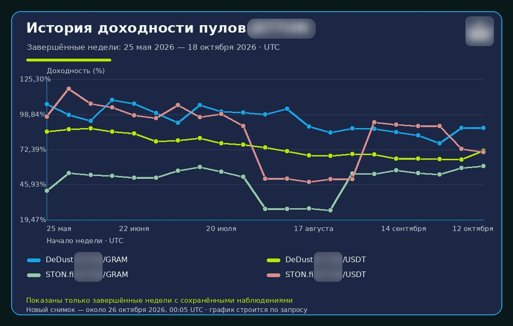
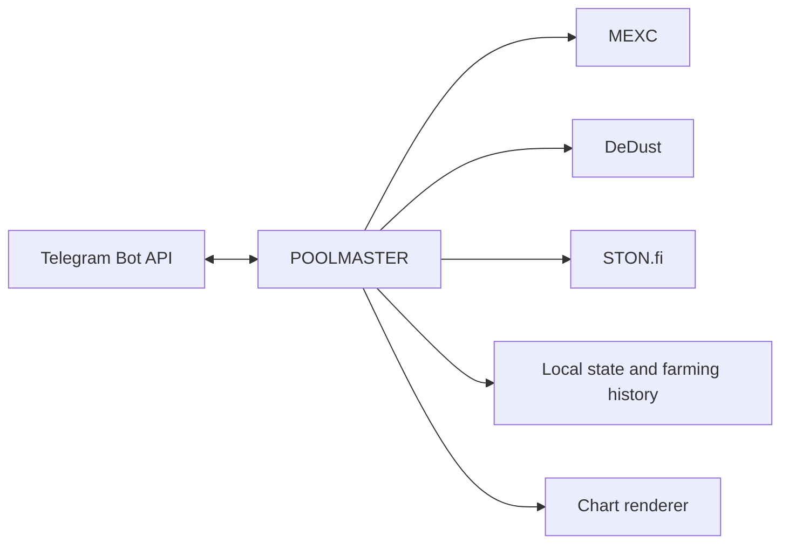

# POOLMASTER

[](https://github.com/DrKarpov/poolmaster-tg/actions/workflows/ci.yml)
[](LICENSE.md)

Telegram bot for JETTON market data, DeFi farming analytics, historical yield charts, and personal alerts.

## Overview

POOLMASTER is a Telegram bot with private menus, group commands, inline results, and charts rendered by the bot. It reads market and farming data from public APIs and stores user preferences and farming history locally. It has no web frontend, Mini App, wallet integration, or exchange trading.

## Preview

### Price chart



A MEXC Spot chart with candles, volume, moving average, and UTC timestamps.

### Farming analytics



Weekly farming-yield history for the configured DeDust and STON.fi pools.

## Features

- MEXC `JETTONUSDT` market data and server-rendered 1h / 12h charts.
- DeDust and STON.fi farming yields and total value locked where available.
- Persisted farming observations and completed-week history charts.
- Personal price and farming alerts with per-user preferences.
- Telegram inline price and farming summaries.
- `/price` and `/farming` group commands.
- Admin tools for broadcasts and managed channel/group publications.
- Russian and English private interface.

## Architecture



Market and farming API calls are read-only. See [Architecture](docs/ARCHITECTURE.md) and [Data sources](docs/DATA_SOURCES.md) for details.

## Data reliability

The application checks source identity, response shape, and data freshness. It bounds and labels stale display fallbacks, confirms large anomalies with another sample, and records only confirmed fresh farming observations in history. See [Data sources](docs/DATA_SOURCES.md) and [Farming history](docs/FARMING_HISTORY.md).

## Local development

Python 3.12 is used by CI. Create an isolated environment and install the development requirements:

```bash
python3.12 -m venv .venv
.venv/bin/python -m pip install -r requirements-dev.txt
cp .env.example .env
```

Use a dedicated test bot token for a local run. **Do not use production credentials for local development.** Keep `.env` private and do not commit it. Start the bot with `.venv/bin/python bot.py` only when a dedicated test token is configured.

Run the automated checks with dotenv loading disabled:

```bash
PYTHONPATH=. PYTHON_DOTENV_DISABLED=true .venv/bin/python -m pytest -q
.venv/bin/python -m compileall -q .
.venv/bin/python -m pip check
git diff --check
```

More detail is in [Configuration](docs/CONFIGURATION.md) and [Testing](docs/TESTING.md).

## Security

The application does not use exchange API keys or wallet keys. Telegram credentials, administrator IDs, user preferences, destination settings, and runtime state must remain private and outside Git. External market calls are read-only. See [Security](SECURITY.md).

## Public repository scope

This is a public source snapshot derived from POOLMASTER v1.0.0 for portfolio and technical review. It includes a minimal public-only compatibility change so charts render when private branding assets are absent. Private branding and deployment-specific assets are intentionally excluded; this snapshot is not a byte-for-byte copy of the private production tree.

## License

**This software is NOT open source.** The source is publicly visible for review and portfolio evaluation only. Use, deployment, modification, redistribution, derivative works, incorporation into another product, and commercial or non-commercial operational use require prior explicit written permission. See [POOLMASTER Source Review License v1.0](LICENSE.md).

## Disclaimer

Market and yield information is informational and is not investment or financial advice. Third-party data may be delayed, unavailable, or incorrect. The software does not control funds or place trades and is provided without warranty. See [Disclaimer](DISCLAIMER.md).
