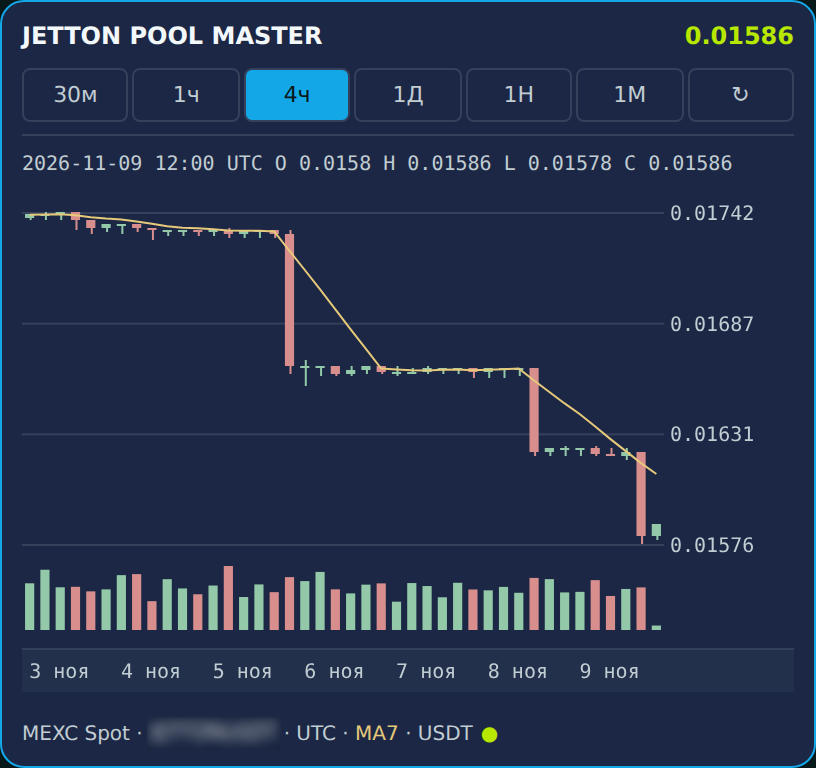
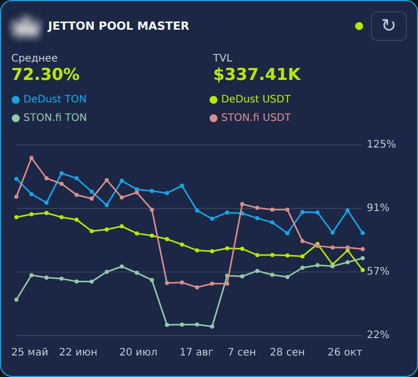

# POOLMASTER

[English](README.md) · [Открыть бота](https://t.me/JETTONPOOL_BOT)

Telegram-бот для цены JETTON, истории доходности пулов и персональных уведомлений. Обновление v1.1.0 добавляет интерактивные виджеты в сообщениях Telegram и независимые очереди пользователей.

**Код открыт для просмотра, но проект не является open source.** Использование, запуск, развёртывание, изменение и распространение требуют предварительного письменного разрешения. Условия определяет [POOLMASTER Source Review License v1.0](LICENSE.md).

## Цена

Свечи MEXC Spot, объёмы и MA7. Фреймы 30м, 1ч, 4ч, 1Д, 1Н и календарный месяц выбираются внутри виджета. Перетаскивание графика листает историю, полосы времени — меняет горизонтальный масштаб. Касание показывает время и OHLC свечи. ↻ обновляет котировку и подпись за 24 часа, «Назад» возвращает в меню. Навигация не подменяет текущую цену историческим значением.

## Фарминг

Четыре линии DeDust/STON.fi и завершённые недели. Касание точки показывает значения четырёх пулов; повторное касание точки или карточки закрывает её. Все недели помещаются без перетаскивания. Сверху — текущее равновзвешенное среднее и общий TVL; обновление доступно в виджете. Это среднее отличается от среднего за весь исторический период. [Выбранная неделя](docs/assets/widgets/farming-detail.png).

## Монетка

Касание подбрасывает монетку: сторона со знаком или гладкий оборот, вероятность 50/50. Сохранены блик, разная скорость, отскок и вибрация на поддерживаемых клиентах. Без ставок, статистики и серверного запроса на бросок. В публичных исходниках используется векторный TST вместо приватной короны.

Изображения — рендеры действующего интерфейса с сохранёнными рыночными данными. Логотипы и связанный тикер размыты. Это не текущие котировки и не снимки личной переписки. Отличия публичного кода описаны в [PROVENANCE.md](PROVENANCE.md).

## Возможности и ограничения

Персональные уведомления, язык, админ-панель и управляемые публикации сохранены. Очереди пользователей и виджетов независимы; лимит активной работы настраивается. Это не отменяет ограничения Telegram и источников.

Виджеты работают в личке. В группах остаются команды с обычными графиками и текстовые Inline-ответы. Дневной/трёхдневный фарминг и групповые Inline-виджеты не включены. Отсутствующие данные не выдумываются; подтверждённый 0% сохраняется. В исходной конфигурации виджеты выключены по умолчанию.

Проверены телефон владельца и Windows Telegram Desktop 7.4.1; поддержка всех версий Telegram не заявляется. Отдельного сайта, Mini App, подключения кошелька и торговли нет.

## Документация

[Архитектура](docs/ARCHITECTURE.md) · [Виджеты](docs/TELEGRAM_WIDGETS.md) · [Пользовательское руководство](docs/USER_GUIDE.md) · [Администрирование](docs/ADMIN_GUIDE.md) · [Конфигурация](docs/CONFIGURATION.md) · [Источники](docs/DATA_SOURCES.md) · [История фарминга](docs/FARMING_HISTORY.md) · [Проверки](docs/TESTING.md) · [Изменения](CHANGELOG.md)

Технические команды предназначены для отдельно авторизованных сопровождающих и не расширяют лицензию. Токены, данные пользователей, эксплуатационные материалы и приватная Git-история не публикуются. См. [SECURITY.md](SECURITY.md), [NOTICE.md](NOTICE.md), [сторонние компоненты](THIRD_PARTY_NOTICES.md) и [правила участия](CONTRIBUTING.md).

Данные информационные, не инвестиционная рекомендация. Бот не распоряжается средствами и не совершает сделки. [DISCLAIMER.md](DISCLAIMER.md).
