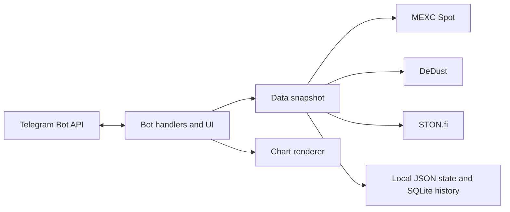

# Architecture

POOLMASTER is a single-process Telegram long-polling bot. It has no web frontend, Mini App, webhook service, wallet integration, or order-execution component.

## Components

- `bot.py` wires Telegram handlers and background tasks.
- `snapshot.py` coordinates market and farming sources, freshness and identity checks, stale display data, anomaly confirmation, and history writes.
- `price.py` and `chart_source.py` read MEXC market data and candles; `chart.py` renders price charts.
- `farming.py` validates DeDust and STON.fi pool/farm responses.
- `farming_history.py` stores observations and builds completed-week summaries; `farming_history_chart.py` renders the history chart.
- `user_ui.py`, `admin_ui.py`, `keyboards.py`, and `localization.py` render private, group, inline, and admin experiences.
- JSON files store private user preferences, admin state, and managed destinations. SQLite stores farming history.

## Boundaries

- Public APIs are read-only; POOLMASTER does not place trades or control funds.
- Personal alert preferences and admin state are private. Group and inline answers do not expose them.
- Personal alerts and managed-destination schedules are separate controls.
- New managed destinations start with publication disabled and are checked against Telegram membership and posting rights.

See [Configuration](CONFIGURATION.md), [Data sources](DATA_SOURCES.md), and [Security](../SECURITY.md).
