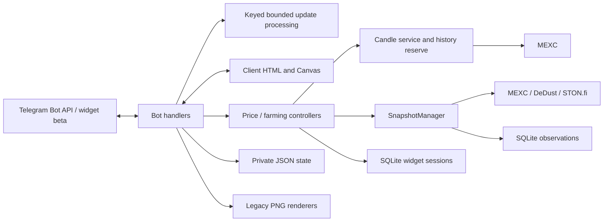

# Architecture

POOLMASTER remains a single-process, long-polling Telegram bot. Interactive HTML/Canvas executes inside Telegram message widgets; no separately hosted frontend, Mini App, public webhook, wallet or order-execution service is introduced.

## Components

- `bot.py` wires handlers, background tasks and the existing single poller. `widget_updates.py` adapts beta widget-query fields without starting another poller; `widget_transport.py` validates send/edit/query boundaries.
- `update_processing.py` maintains per-user/widget-message FIFO queues and bounds active handlers with `UPDATE_CONCURRENCY` (16 by default). Shutdown drains owned work before closing clients. This limit measures executing work, not registered users.
- `chart_data.py` validates candle windows, shares bounded caches and merges identical in-flight loads. `chart_source.py` reads MEXC candles. `chart_widget.py` packs exact values and loads localized HTML; `chart_widget_controller.py` manages quote-preserving navigation and refresh.
- `farming_widget_data.py` derives completed-week points, current mean and complete TVL. `farming_widget.py` encodes them; `farming_widget_controller.py` refreshes sources and edits the same message.
- `chart_widget_state.py` persists bounded sessions/transitions. Separate price and farming SQLite databases sit beside user state. Ownership, revisions, closure and interrupted transitions are checked before accepting actions.
- `coin_widget.py` sends the menu. Random outcome, drawing, haptics and animation stay on the client; a toss needs no bot query.
- `widget_compat.py` inserts the common numeric bootstrap. It detects the demonstrated Desktop decimal-comma JSON defect; correct engines take the no-op path. The sandbox/validator boundary is retained.
- `snapshot.py`, `price.py` and `farming.py` coordinate source identity, freshness, anomaly confirmation and accepted observations. `farming_history.py` stores daily observations and builds completed-week summaries.
- `user_state.py` uses locked copy-on-write mutations and atomic replacement; failed persistence restores in-memory state. `admin_state.py` and `managed_destinations.py` keep separate state domains.
- `chart.py` and `farming_history_chart.py` retain PNG fallback/group rendering. Private logos are optional in this public snapshot; widgets use the public TST mark. See [Provenance](../PROVENANCE.md).

## Background work and boundaries

Personal alert polling, confirmed daily history collection and managed publications are separate. Daily collection checks actual current-day coverage for all pools and retries incomplete/failed collection after 300 seconds; genuine confirmed 0% counts. Failed writes retain observations for persistence retry. Cached or seed rows do not satisfy live collection coverage.

New destinations start with schedules disabled. Identity/posting rights and administrator authorization are checked; losing rights disables scheduling, restoring rights does not silently enable it. Group commands do not enroll a group into managed publications.

Read-only price-history reserve responses do not edit the quote, caption, keyboard or message session; incoming candles wait for gesture release. Explicit refresh and timeframe transitions remain separate actions. Back closes the session so late work cannot reopen it.

Public APIs are untrusted until validation succeeds. Telegram credentials, identities, preferences, destination records and session databases are private. Test fixtures are synthetic; no production state is shipped.

[Widgets](TELEGRAM_WIDGETS.md) · [Configuration](CONFIGURATION.md) · [Data sources](DATA_SOURCES.md) · [Security](../SECURITY.md)
